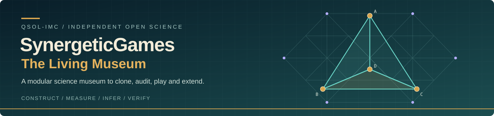

[**Enter the museum**](https://qsolkcb.github.io/SynergeticGames/) · [**Open the Contributor Workshop**](https://qsolkcb.github.io/SynergeticGames/workshop.html) · [**Start here**](docs/VISITOR_GUIDE.md)

**A modular science museum that can be cloned, audited, played and extended.**

Discover mathematics by doing mathematics. Walk through interactive exhibits, change a representation, make a prediction, test a relationship and inspect the evidence. A museum is not a textbook with a movement controller: the interaction itself should reveal the idea.

Built for the School of Tomorrow by QSOL-IMC as independent contributors to open science. **We are not members of the School of Tomorrow.** This is an independent contribution, not an official publication, affiliation or endorsement.

[Play the current museum expedition](https://qsolkcb.github.io/SynergeticGames/) · [Roadmap](ROADMAP.md) · [Design charter](docs/MUSEUM.md) · [Exhibit authoring](docs/EXHIBITS.md) · [Sources](docs/SOURCES.md) · [Verification](docs/VERIFICATION.md)

## Start here

| I want to… | Read or open |
| --- | --- |
| Explore the museum or play Concentric | [Visitor guide](docs/VISITOR_GUIDE.md) |
| Create an exhibit without writing code | [Authoring guide](docs/AUTHORING_GUIDE.md) |
| Turn a complex idea into an understandable interaction | [Educator and researcher guide](docs/TEACHING_GUIDE.md) |
| Build my own mathematical model or fork | [Modding guide](docs/MODDING_GUIDE.md) · [SDK](docs/SDK.md) |
| Check browser requirements and troubleshoot | [Compatibility guide](docs/BROWSER_COMPATIBILITY.md) |
| Reproduce results and review a release | [Verification](docs/VERIFICATION.md) · [Acceptance](docs/RELEASE_ACCEPTANCE.md) |

## Visit the museum (v1.0.0 candidate)

Open **Museum catalogue** for twenty-four standalone experiments, an optional guided route and access to the Concentric finale. Explore freely or follow a route with Previous/Next; export or load route JSON, revisit experiments, reset an individual lab and download its state. Completion counts describe standalone experiments only; they never award expedition seals. No account or persistent museum-wide profile is required. See [release acceptance](docs/RELEASE_ACCEPTANCE.md).

## The Measurement Gallery

Three new independent experiments extend the Volume Exchange: **The Conversion Desk** (bidirectional XYZ/IVM conversion), **The Pythagorean Transfer** (similar figures and area accounting), and **The TetraBook** (hinged equilateral triangles and volume). See [Measurement Gallery](docs/MEASUREMENT_GALLERY.md) for mathematical conventions, source attribution and tests.

## The Geometry Workshop

Construct integer Quadrays, grow FCC/IVM shells and build equal-edge tetrahedral, octahedral and cuboctahedral cells. See [Geometry Workshop](docs/GEOMETRY_WORKSHOP.md) for exact coordinate bounds, independent oracles and source references.

## The Information Gallery

Switch observer views, share truthful observations, filter possible worlds and compare disclosure orders in a bounded maximin decision game. See [Information Gallery](docs/INFORMATION_GALLERY.md) for models, assumptions, scope and tests. The Inference Gallery extends these finite information models with a separate probability model.

## The Inference Gallery — The Hidden Tetrahedron

Enumerate exact rational posteriors, step normalized sum-product messages on a tree, compare a loopy tetrahedron and investigate global contradiction. See [Inference Gallery](docs/INFERENCE_GALLERY.md) for priors, schedules, precision, counterexamples and scope. Classical binary inference, not a validated QEC decoder.

## The Topology Gallery

Construct face-closed simplicial complexes, reverse orientations, compare GF(2) and GF(3), and calculate Betti numbers and cycle/boundary witnesses. See [Topology Gallery](docs/TOPOLOGY_GALLERY.md) for the exact bounded model and independent kernel oracle.

## The Experimental Annex

Run exact-reference quadrature, dimensionless oscillator refinement and exhaustive inference sweeps. Retain failed or inconclusive observations and download versioned, locally verifiable evidence. See [Experimental Annex](docs/EXPERIMENTAL_ANNEX.md). Unpublished elastic-loop material remains deferred behind the source/permission gate.

## Founding collection: Concentric — The Field Station Edition

The released v0.2.0 game is the founding exhibit collection. Pip and Mica explore a 2.5D geometric field station, restore four experiments and link their perspectives. The Department of Unnecessary Cubes still has a paperwork problem.

| Exhibit | Interactive discovery |
| --- | --- |
| The Minimum Department | Construct a tetrahedron from four vertices and six struts. |
| The Volume Bureau | Discover equal-edge tetravolume ratios 1 : 4 : 20. |
| Neighbourhood Watch | Pair the twelve FCC/IVM nearest-neighbour directions. |
| The Coordinate Office | Remove a shared Quadray offset without moving the point. |
| The Concentric Engine | Bring both probes into mutual visibility and alignment. |

There is no combat, countdown, account or penalty for experimenting. The final relay is fiction, not a physical law. Volume comparisons do not assert that whole regular tetrahedra tile a regular octahedron.

### Visitor controls

| Control | Action |
| --- | --- |
| W / S or up / down | Move forward / backward |
| A / D | Strafe |
| Left / right or drag | Turn |
| E / Inspect | Open a nearby exhibit |
| Q | Switch probe |
| F | Face the other probe |
| Space | Hold to synchronise |
| P / Escape | Pause / resume |
| Tab | Normal keyboard focus |

Follow the coloured trails; the compass points towards the next unfinished exhibit. Finish all four, bring both probes near the central engine, face each other and hold the link for two seconds. Touch, reduced motion, fit window, fullscreen, local saves, JSON download/restore and original WAV export are supported. Sound is opt-in. See [the original Field Station README](README_HISTORY.md).

## The museum we are building

**The initial museum host:** a shared catalogue with independently testable founding exhibits. The catalogue includes the galleries below; external data-pack authoring and reviewed native contributions are supported. A visitor can explore freely or follow an educational route. The Experimental Annex offers bounded research experiments. The same exhibit should support an accessible first encounter and an inspectable mathematical explanation; advanced tools are optional.

| Gallery | Available and future exhibits |
| --- | --- |
| Geometry | Expanded lattice and kinematic investigations; Quadray Workshop, IVM Builder and Cell Foundry are in the catalogue |
| Measurement | Further volume-from-edges experiments; Volume Exchange, Conversion Desk, Pythagorean Transfer and TetraBook are in the catalogue |
| Information | Observer Room, Evidence Ledger and Disclosure Theatre are in the catalogue |
| Inference | Exact Oracle, Message Tree, Hidden Tetrahedron and Contradiction Room are in the catalogue |
| Topology | Simplex Builder, Boundary Studio and Homology Laboratory are in the catalogue |
| Research annex | Quadrature Bench, Oscillator Laboratory and Inference Sweep; candidate elastic-loop work remains gated |
| Workshop | Author, preview, export and install data packs; edit routes; inspect research evidence |

Our teaching inspiration includes [Kirby Urner's School of Tomorrow](https://github.com/4dsolutions/School_of_Tomorrow), [Ryan's RayShare](https://github.com/RyanJBuchanan/RayShare) and [Synergetics 95](https://qsolkcb.github.io/synergetics2/#/home). Public source materials are references, not a blanket licence to copy everything or a claim of contributor endorsement.

## Clone and play

No npm install, CDN, Docker, account or application server required. Native HTML/CSS/JavaScript; Python serves static files.

```sh
git clone https://github.com/QSOLKCB/SynergeticGames.git
cd SynergeticGames
uv run --no-project python -m http.server 8765 --bind 127.0.0.1
```

Open http://localhost:8765. A static HTTP origin is required for native modules; file:// is not supported. After a complete HTTP(S) load and service-worker installation the current game supports offline reload. External reference links require connectivity.

## Audit

```sh
node --test tests/*.test.js
uv run --no-project --python 3.12 --with playwright==1.62.0 python -m playwright install chromium firefox webkit
BROWSER_ENGINE=chromium uv run --no-project --python 3.12 --with playwright==1.62.0 python tests/browser.py
BROWSER_ENGINE=firefox uv run --no-project --python 3.12 --with playwright==1.62.0 python tests/browser.py
BROWSER_ENGINE=webkit uv run --no-project --python 3.12 --with playwright==1.62.0 python tests/browser.py
```

Node is a development test runner only. Browser checks exercise actual gameplay, save validation, offline reload, sound, layout and focus. Current receipts and screenshots are written under test-results/<engine>/. WebKit is not a substitute for testing the installed Safari browser on the intended Mac. See [verification scope](docs/VERIFICATION.md); historical PASS results do not certify a new commit.

[Source provenance](vendor/PROVENANCE.json) records pinned upstream revisions and file hashes. The existing runtime modules are byte-identical to [VANILLAJS v3.5.0](https://github.com/QSOLKCB/VANILLAJS/releases/tag/v3.5.0); the engine bridge adds its exact-rational and exact-graph modules for independently testable museum model foundations. The modular catalogue now exposes the four founding experiments as independent, resettable labs and a route back to the original expedition finale. Open **Museum catalogue** before or during play. The new **Volume Exchange** compares an R-edged cube with a D-edged tetrahedron (D = 2R): predict, measure, rescale and switch units. It is the first new independently registered lab. See [Volume Exchange](docs/VOLUME_EXCHANGE.md). Subsequent galleries add geometry, information, inference, topology and reproducible research experiments.

## Extend

Open workshop.html on the same local HTTP server. No Node installation is needed for authoring or playing. Download a data-only pack and load it in the museum; native extensions use the reviewed contributions.js list. See [SDK](docs/SDK.md) and [example pack](assets/example-pack.json).

Start with [Contributor Workshop](workshop.html), [CONTRIBUTING.md](CONTRIBUTING.md) and the stable [exhibit contract](docs/EXHIBITS.md). An exhibit should have a question, an interaction, a mathematical or experimental model, source attribution and a way to check its result. Educators can propose an exhibit without writing code.

Pull requests validate; only main deploys through GitHub Actions. No merge without owner authorization.

Original code, score, graphics and writing are Apache-2.0. Retained RayShare code is MIT and retained Synergetics 95 geometry is MPL-2.0; see [NOTICE.md](NOTICE.md). Preserve licences and provenance at the file level.

**Geometry is a team sport. Science is something you can do. :-)**
